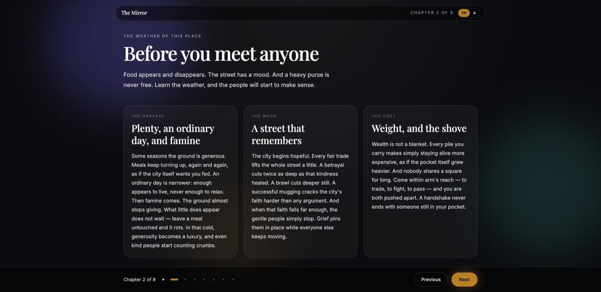
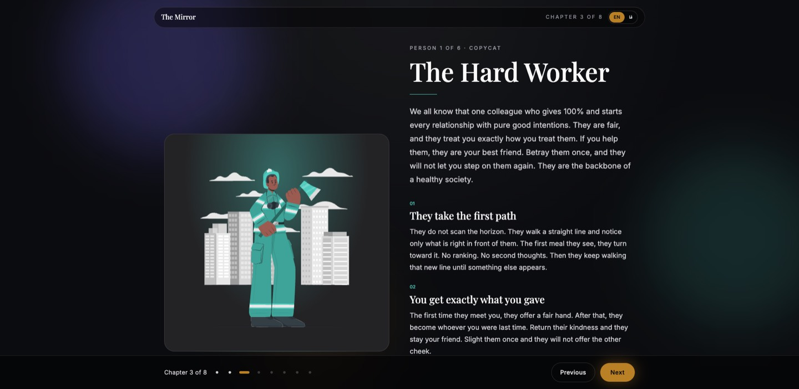
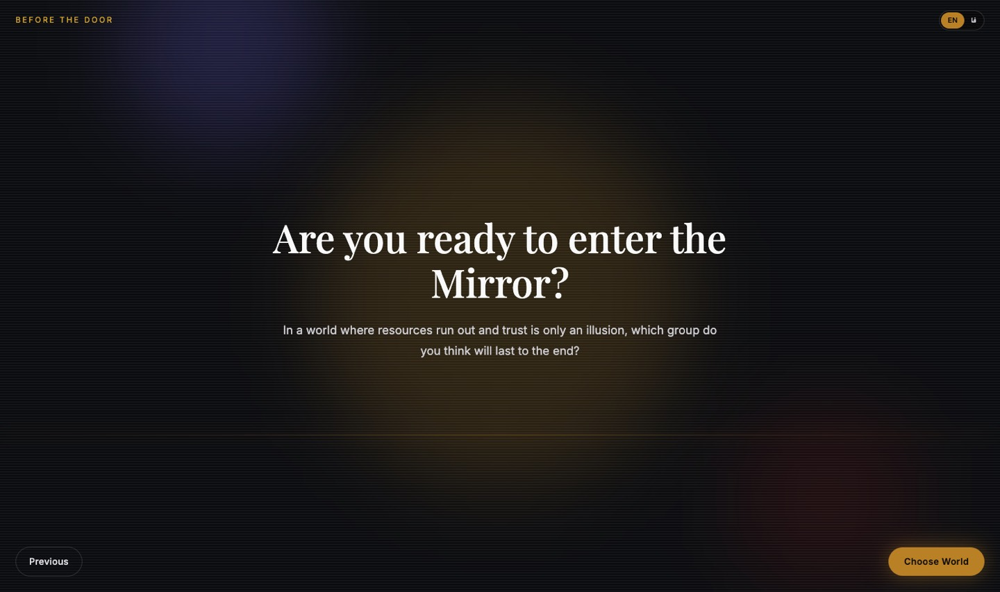
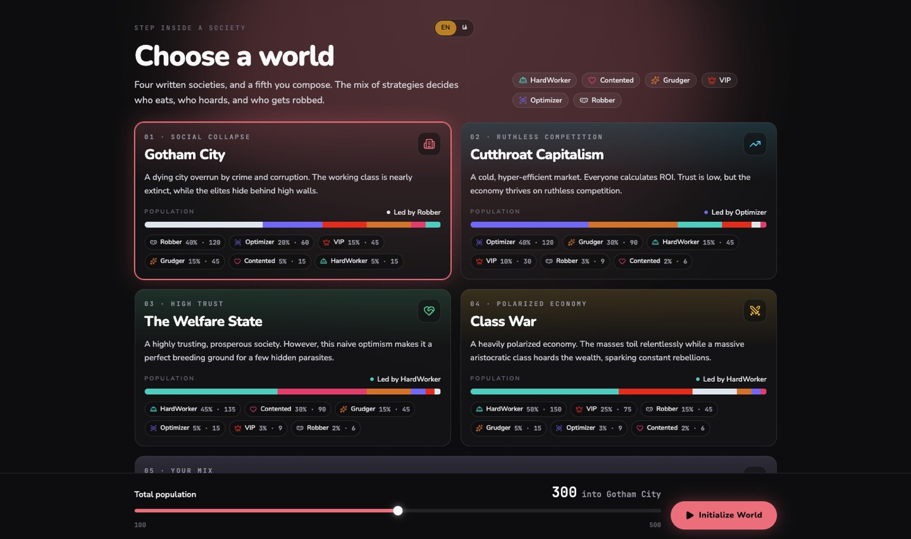
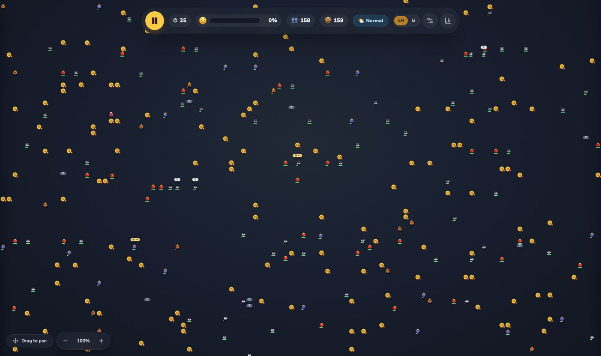
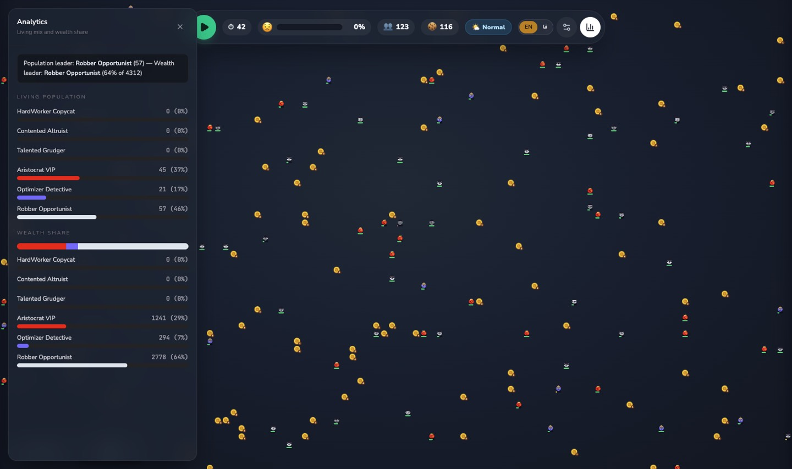
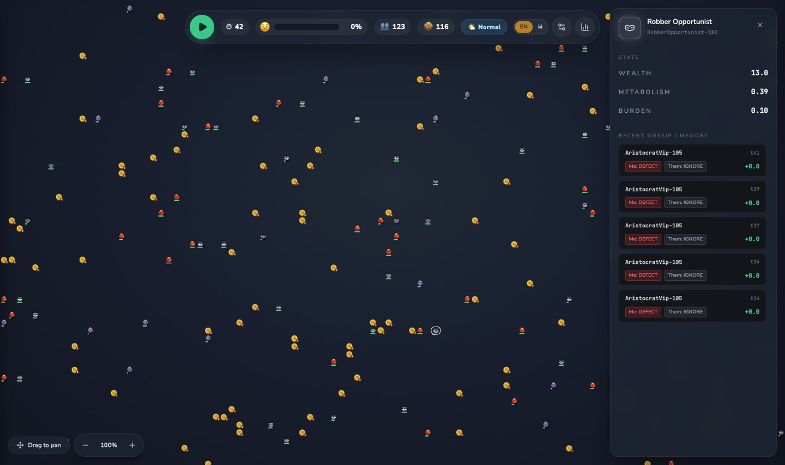

# The Mirror of Society

A sociological sandbox. Six personalities. Limited food. A street that remembers every kindness and every betrayal.

You do not play a character. You walk through an exhibition, meet the people who will populate the city, then choose which society to set in motion and watch who eats, who hoards, and who gets robbed.


The interface is in English and Persian. Switch language from the pill in the top bar at any point in the exhibition or during the simulation.

## Run it

```bash
pnpm install
pnpm dev
```

Then open the URL Vite prints (usually `http://localhost:5173`).

| Script | What it does |
| --- | --- |
| `pnpm dev` | Start the dev server |
| `pnpm build` | Typecheck and build for production |
| `pnpm preview` | Serve the production build |
| `pnpm lint` | Run ESLint |

Your place in the exhibition is saved in the browser. The landing page always stays put. **Start Journey** begins again at the first chapter. Once you have reached the hype screen, **Continue** opens that screen directly.

## A session

The exhibition is a fixed walk. Each chapter unlocks the next.

1. **The door.** The landing page introduces the premise.
2. **The weather.** Before any person appears, you learn how food, trust, and wealth behave.
3. **Six people.** One chapter each, with a portrait and the rules they actually live by.
4. **The question.** A short beat asks which group you think will last.
5. **A world.** Four written societies, or a mix you compose yourself.
6. **The city.** The simulation starts on its own. Pause it, pan the map, and read what the street is doing.



*The weather chapter. Food, the city's mood, and the weight of a full purse.*



*Person 1 of 6. Each personality has a portrait and three rules. The other five follow the same layout: Contented, Talented, Optimizer, Aristocrat, Robber.*



*The beat between the last portrait and the world picker.*



*Choose a written society or compose your own. The slider sets a population between 100 and 500.*

## The six personalities

Everyone shares one body: a position on the grid, a purse of wealth, a vision radius, a metabolism, and a memory of the last few meetings. Wealth ticks down every second just for being alive. At zero, they die. What differs is how they look for food and what they do when they bump into someone.

| | How they move | How they meet you |
| --- | --- | --- |
| **Hard Worker** · Copycat | Short sight. Walks a straight line and turns toward the first meal in front of them. | Opens with a fair hand. After that, they become whoever you were last time. |
| **Contented** · Altruist | Stops chasing once they have a little put aside, and steps away from a crowd. | Always offers the fair hand. Almost never fights off a thief. |
| **Talented** · Grudger | Sees farther, and still refuses cheap meals. If nothing meets the standard, they stand still and burn. | Warm the first time. One remembered betrayal and the door stays shut. |
| **Optimizer** · Detective | Sees the whole neighborhood and only walks if the meal is worth the trip. | Fair once, then betrays you to test you. Strike back and they respect you. Stay soft and they keep taking. |
| **Aristocrat** · VIP | Does not hunt. Rent arrives on its own, and sometimes they take a slow stroll. | Ignores ordinary people. Two of them greet each other and both leave richer. |
| **Robber** · Opportunist | Hunts people, not meals. Poor, they chase whoever is closest. Comfortable, they chase the richest person they can see. | Never offers a deal, and never hunts their own. |

A few details that change the outcome:

- **Contented people freeze** when societal trust falls far enough. Grief pins them in place while everyone else keeps moving.
- **Optimizers can lock up.** Looking at too many meals at once costs them, and then they freeze. Simpler neighbors walk past and eat.
- **Aristocrats start rich and nearly blind**, with the highest cost of living and the tightest locks. They survive because money keeps appearing.
- **A heavy purse is not free.** Every pile of wealth makes simply staying alive more expensive, for every personality.

## The worlds

The mix is the experiment. Population defaults to 300 and can sit anywhere from 100 to 500. **Custom** lets you set each headcount yourself, up to 500 people in total.

| World | The bet | Who leads it |
| --- | --- | --- |
| **Gotham City** | A dying city. Crime is the majority. The working class is nearly gone, and elites sit behind high walls. | Robber 40% |
| **Cutthroat Capitalism** | A cold market. Almost everyone prices the next step. Trust is scarce, competition is not. | Optimizer 40% |
| **The Welfare State** | A trusting, prosperous street, with a few parasites hidden in it. | Hard Worker 45% |
| **Class War** | The masses toil. A large aristocratic class collects rent. Robbers feed on the gap. | Hard Worker 50% |

The bars on each card are the exact starting mix at the current population.

## What the city does

The board is a grid. The clock advances one **tick** per second. Cookies appear, people walk, and anyone who shares a square has an encounter. Then they are pushed apart. A handshake never ends with someone still in your pocket.



*Gotham City a few seconds in. Drag to pan. The control in the corner zooms the street.*

### Food and seasons

Cookies spawn across the map, each worth a small amount of wealth, and they rot if nobody picks them up. The season changes how generous the ground is:

- **Boom** keeps meals turning up.
- **Normal** is enough to live, never enough to relax.
- **Bust** almost stops giving.

The season chip in the HUD shows which one you are in. Settings can switch it without rebuilding the city, and can scatter a fresh batch of cookies onto the ground.

### Meetings

When two living people collide, the encounter resolves in this order:

1. **Two aristocrats** recognize each other. Both collect from the club. No trade, no fight.
2. **Anyone who ignores the meeting** walks away with nothing exchanged. Aristocrats ignore anyone who is not one of them.
3. **A robber** attempts a grab. The victim's defense is a chance to fight them off. A successful mugging takes a serious cut of the victim's purse and cracks the city's faith. If the victim fights them off, the grab fails.
4. **Everyone else** plays a small prisoner's dilemma:
   - Both cooperate, and both gain a little. Trust rises.
   - One defects while the other cooperates, and the betrayer takes more while the other loses. Trust falls.
   - Both defect, and both lose. Trust falls harder.

Each person stores a short memory of who did what. That memory is what Copycats, Grudgers, and Optimizers consult next time.

### Societal trust

The city starts hopeful, at full trust. Fair trades lift it. Betrayal cuts deeper than kindness heals. A brawl cuts deeper still. A successful mugging cuts deepest. The face and the bar in the HUD are that number. When it collapses, the Contented stop moving.

### While it runs

- **Pause / play** sits on the left of the HUD. The simulation starts on its own after the world is built.
- **Analytics** shows who is still alive and who holds the wealth. In a hard city the two answers diverge quickly.



*Analytics on the same Gotham run. Hard Workers, the Contented, and the Talented are already gone. Robbers hold most of what is left.*

- **Click a person** to open their purse, their cost of living, the burden of what they carry, and the last few meetings they remember.



*Inspect. The selected person is highlighted on the map.*

- **Settings** changes the season immediately, scatters more cookies, or rewrites the headcount of each personality and restarts the city.

## How the code is split

```
src/
  core/                 the simulation, with no React
    constants/config.ts seasons, payoffs, stats, and each personality's thresholds
    engine/GameLoop.ts  one tick: aging, movement, pickups, collisions, spawns
    entities/           BaseAgent and the six personalities
    mechanics/          encounters and the event log
  store/                Zustand: the engine, play/pause, and the open panel
  ui/                   exhibition, world picker, map, HUD
  i18n/                 English and Persian copy
```

The engine does not know about the screen. Each tick, agents see only what falls inside their vision, choose a step, then the engine resolves cookies, deaths, and collisions. The UI reads a snapshot of that state once a second.

Numbers that change the sociology — spawn rates, cookie lifetime, cooperate/defect payoffs, vision, metabolism, defense, the trust level that freezes the Contented — all live in [`src/core/constants/config.ts`](src/core/constants/config.ts).

## Stack

React 19, TypeScript, Vite, Tailwind CSS 4, React Router, Zustand, and Motion. Sound uses Howler through `use-sound`.
